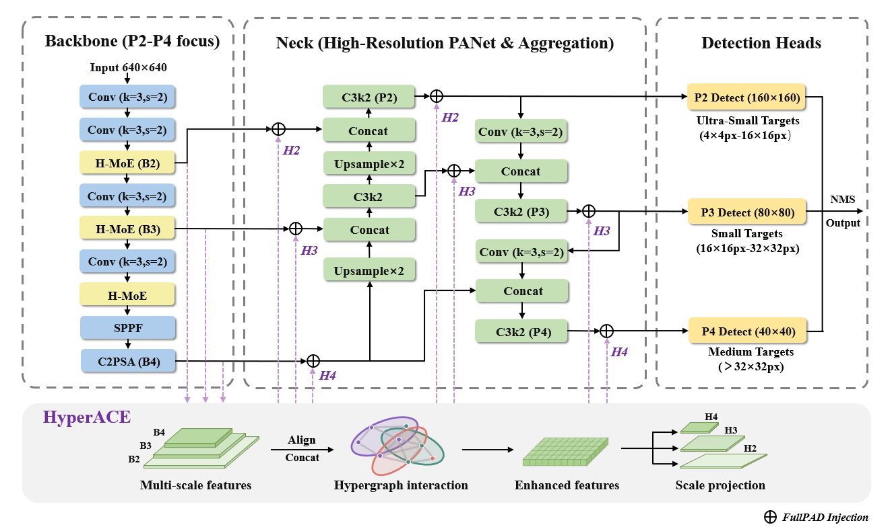

# P2H-YOLO

This repository provides the implementation of **P2H-YOLO** for small object detection.

<p align="center">
  
</p>

P2H-YOLO is a YOLO26-based model for small object detection that incorporates a **Heterogeneous Mixture-of-Experts (H-MoE)** module and a **HyperACE** module for hypergraph-based feature enhancement. The model replaces the low-resolution P5 detection branch with a high-resolution P2 branch, forming a three-scale **P2/P3/P4** detection architecture. The H-MoE module uses dynamic Top-2 routing to select two experts and fuse their output features. HyperACE captures higher-order contextual relationships across scales, and the enhanced features are injected into the network through FullPAD. The detection head retains the one-to-many supervision branch and uses distributional bounding box regression.

The model is evaluated on three datasets, **VisDrone2019**, **AI-TODv2**, and **Pest24**, spanning UAV imagery, remote sensing imagery, and agricultural pest detection.

## Catalogue

- [Getting Started](#getting-started)
- [Key Files and Folders](#key-files-and-folders)
- [Data Processing](#data-processing)
- [Start Training](#start-training)
- [Evaluation](#evaluation)

## Getting Started

### 1. Clone the Repository

Clone this repository and enter its root directory:

```bash
git clone https://github.com/xuanmengku/P2H-YOLO.git
cd P2H-YOLO
```

### 2. Set Up the Environment

Create a conda environment and install the dependencies:

```bash
conda env create -f environment.yml
conda activate p2h-yolo
```

## Key Files and Folders

| File or Folder | Purpose |
| --- | --- |
| `dataset_configs/` | Dataset YAML configuration files |
| `ultralytics/cfg/models/26/yolo26-p2h.yaml` | P2H-YOLO model architecture configuration |
| `ultralytics/nn/modules/moe/modules.py` | H-MoE implementation (named `ES_MOE` in the code) |
| `ultralytics/nn/modules/block.py` | HyperACE implementation |
| `README.md` | Project documentation (this file) |
| `environment.yml` | Conda environment configuration |
| `train_p2h.py` | Training entry point |

The training script loads `yolo26m-p2h.yaml` to build the M-scale P2H-YOLO model.

| Model scale | Depth multiplier | Width multiplier | Maximum channels |
| --- | --- | --- | --- |
| M | 0.67 | 0.75 | 768 |

## Data Processing

### 1. Download Datasets

Datasets of VisDrone2019, AI-TODv2, and Pest24 are kindly uploaded by the authors. You can download them from the following links.

| Dataset | Link |
| --- | --- |
| VisDrone2019 | |
| AI-TODv2 | |
| Pest24 | |

The table below summarizes the key statistics of the three datasets, **VisDrone2019**, **AI-TODv2**, and **Pest24**.

| Items / Datasets | VisDrone2019 | AI-TODv2 | Pest24 |
| --- | --- | --- | --- |
| Training | 6,471 | 5,000 | 12,701 |
| Validation | 548 | 2,804 | 5,077 |
| Testing | 1,610 | 14,018 | 7,600 |
| Categories | 9 | 8 | 24 |
| Total (Images) | 8,629 | 21,822 | 25,378 |

### 2. Dataset Processing

- **VisDrone2019**: We merged the semantically similar `pedestrian` and `person` classes, retaining 9 classes in total.
- **AI-TODv2**: We randomly selected 5,000 images from the official training set for training, leaving the validation and test sets unchanged.
- **Pest24**: We used the original dataset and its provided splits.

To support model training, all annotations are standardized to the YOLO object detection format, with each line representing one object:

```text
class_id x_center y_center width height
```

Class IDs start at 0. Bounding box center coordinates, widths, and heights are normalized to the range 0–1 using the image width and height.

The download links above provide the processed datasets and annotations, so no further conversion is required. Please use the provided dataset splits.

### 3. Dataset Configuration

Check and update the following fields in the corresponding dataset YAML configuration file according to where the dataset is stored locally:

| Field | Description |
| --- | --- |
| `path` | Dataset root directory |
| `train` | Path to training images |
| `val` | Path to validation images |
| `test` | Path to test images |

Finally, set the `data` argument in `train_p2h.py` to the path of the corresponding dataset YAML configuration file to complete data preparation.

## Start Training

### 1. Training Configuration

This project uses `train_p2h.py` to start training. Before training, check the following main settings in the script:

| Setting | Description |
| --- | --- |
| `data` | Path to the dataset YAML configuration file |
| `epochs` | Maximum number of training epochs |
| `batch` | Batch size |
| `imgsz` | Input image size |
| `device` | Training device |
| `workers` | Number of data loading worker processes |
| `pretrained` | Whether to load pretrained weights; currently set to `False`, so pretrained weights are not used |
| `project` | Root directory for training outputs |
| `name` | Name of the training run, used to create the output subdirectory |

See `train_p2h.py` for the complete training settings. When switching datasets, set `data` to the corresponding dataset YAML configuration file path and assign an appropriate `name` to each experiment.

### 2. Launch Training

Activate the Conda environment created earlier, then run the following command from the repository root:

```bash
python train_p2h.py
```

### 3. Training Outputs

Training results are saved in the directory specified by `project` and `name`. The main outputs include model weights, training configurations, etc.

| Weight File | Description |
| --- | --- |
| `weights/best.pt` | Best model weights selected based on validation set performance |
| `weights/last.pt` | Last saved training checkpoint |

After training, use `weights/best.pt` for validation and prediction.

## Evaluation

### 1. Run Evaluation

Load the trained model weights to evaluate detection performance on the test set. Activate the Conda environment created earlier, then run the following command in a Bash terminal from the repository root:

```bash
python - <<'PY'
from ultralytics import YOLO

model = YOLO("path/to/best.pt")

m = model.val(
    data="path/to/dataset.yaml",
    split="test",
    imgsz=640,
    device=1,
    project="path/to/eval_results",
    name="visdrone2019/test",
    exist_ok=True
)

print("mAP50     =", m.box.map50)
print("mAP75     =", m.box.map75)
print("mAP50-95  =", m.box.map)
PY
```

### 2. Configuration Details

The main settings in the command above are as follows:

| Setting | Description |
| --- | --- |
| Weight path in `YOLO(...)` | Path to the model weights to be evaluated |
| `data` | Path to the dataset YAML configuration file |
| `split` | Dataset split used for evaluation; `"test"` selects the test set |
| `imgsz` | Input image size |
| `device` | Evaluation device |
| `project` | Root directory for evaluation outputs |
| `name` | Name of the evaluation run, used to create the output subdirectory |

Replace the model weights path, dataset YAML configuration file path, and output directory in the example with your actual paths, and adjust `device` according to the GPU used. When switching datasets, update the corresponding paths as well.

### 3. Evaluation Results

After evaluation, the terminal will display overall and per-class detection metrics.
